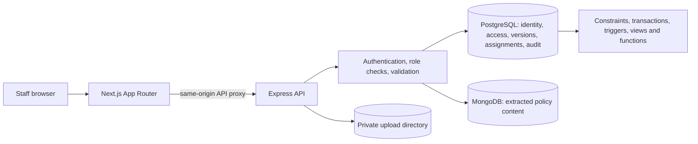

# DocuGuard Lite Architecture

## System context

DocuGuard Lite is a local policy-document workflow for a hospital-like organization. The browser uses the Next.js App Router. Next.js forwards `/api/*` requests to Express. Only Express connects to PostgreSQL and MongoDB.

PostgreSQL is the source of truth for the 11 relational entities. MongoDB stores extracted document content, pages, sections and extraction metadata. It does not make authorization decisions. The original PDF/DOCX file is stored in a private upload directory; MongoDB's content record and PostgreSQL's `mongo_content_id` link to the extracted representation.

## Authentication and access

1. The login form sends credentials to Express.
2. Express verifies the bcrypt hash and sets a signed JWT in an HTTP-only cookie.
3. Protected middleware reloads account status and role from PostgreSQL.
4. Route access uses role names. A document read is allowed only when a non-revoked `DOCUMENT_PERMISSIONS` row grants the caller's role, or when an eligible active emergency override applies.
5. SQL uses the authenticated user id and role in the access predicate. The browser never connects to either database.

## Upload, versioning and approval

1. Express validates a PDF or DOCX, stores it privately under a random name, extracts text/pages, and inserts a content record in MongoDB.
2. One PostgreSQL transaction creates the document/version records, document grants as appropriate, and links the Mongo content id. If SQL fails, Express compensates by deleting the Mongo record; a later orphan sweep handles failed compensation.
3. A different authorized reviewer approves the pending version. A database CHECK enforces maker-checker. The approval trigger changes the document's current-version pointer and supersedes the previous approved version in the same transaction.
4. Downloads and policy access create hash-chained access-log rows.

## Remaining workflows

- The dashboard summarizes document status, expiry, access activity and acknowledgment completion from PostgreSQL views.
- Assignments target roles/departments. Pending acknowledgments are calculated by a version-aware anti-join; acknowledgments are stored only when completed.
- Emergency access creates an expiring override and flagged audit row transactionally. Admin review is a direct queue query over overrides.
- Scheduled expiry logic updates version state. It does not depend on a message inbox.
- An Admin content summary can aggregate MongoDB content metadata using `$facet`, `$unwind` and `$group`; PostgreSQL remains the authorization source for selecting eligible versions.
- Audit verification recomputes the chain and returns a result. Whether to keep the endpoint without persistent verification history is an approval question in `SIMPLIFICATION_PLAN.md`.

## Components

| Area | Responsibility |
|---|---|
| `frontend/` | Login, role-aware navigation, documents, user admin, audit, emergency access/review, assignments and acknowledgments. |
| `backend/src/routes/` | Express endpoints, authentication, role checks, Zod validation and SQL transactions. |
| `backend/src/services/` | Content extraction/ingestion, expiry sweep and audit helpers. |
| `database/postgres/` | Handwritten SQL schema, constraints, indexes, seed, views, functions, triggers and tests. |
| `database/mongo/` | Content indexes, synthetic content seed and content analytics. |
| `docker-compose.yml` | Side-by-side lite PostgreSQL and MongoDB services. |

The repository is currently at the documentation and approval-plan stage; its inherited config and application code have not yet been simplified. Planned lite ports and names are documented in README and will be applied only after plan approval.
